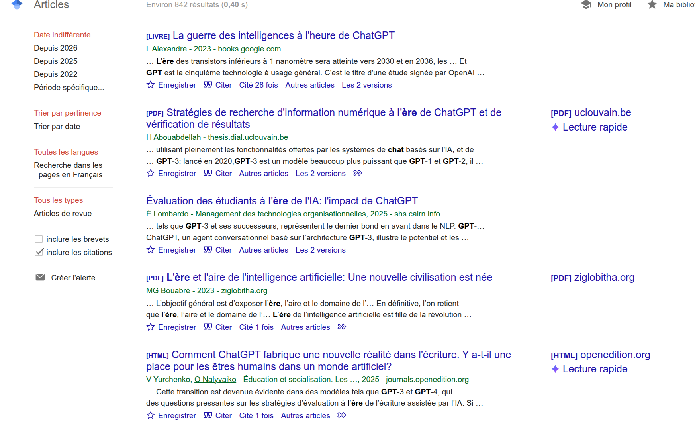
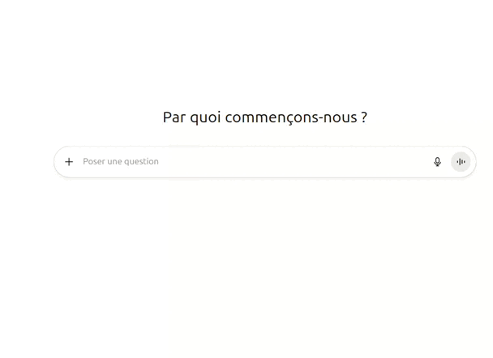
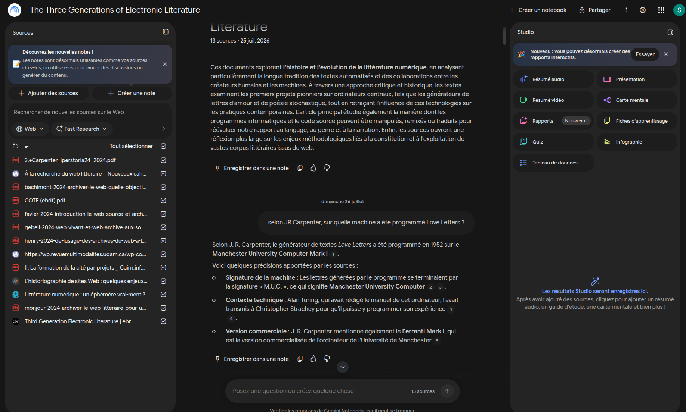
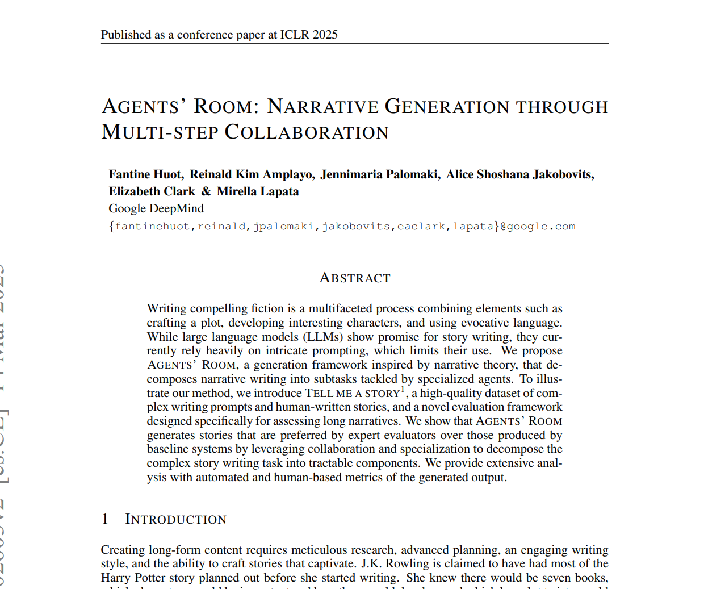
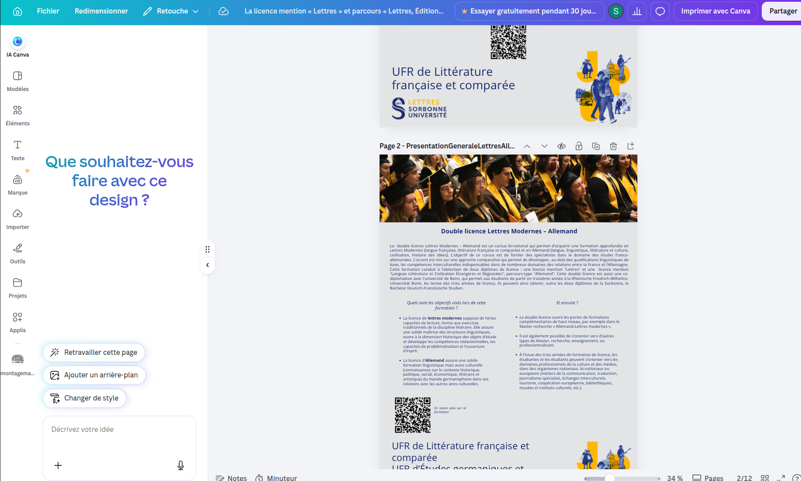
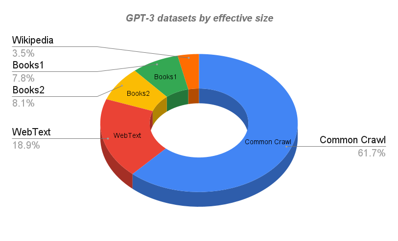
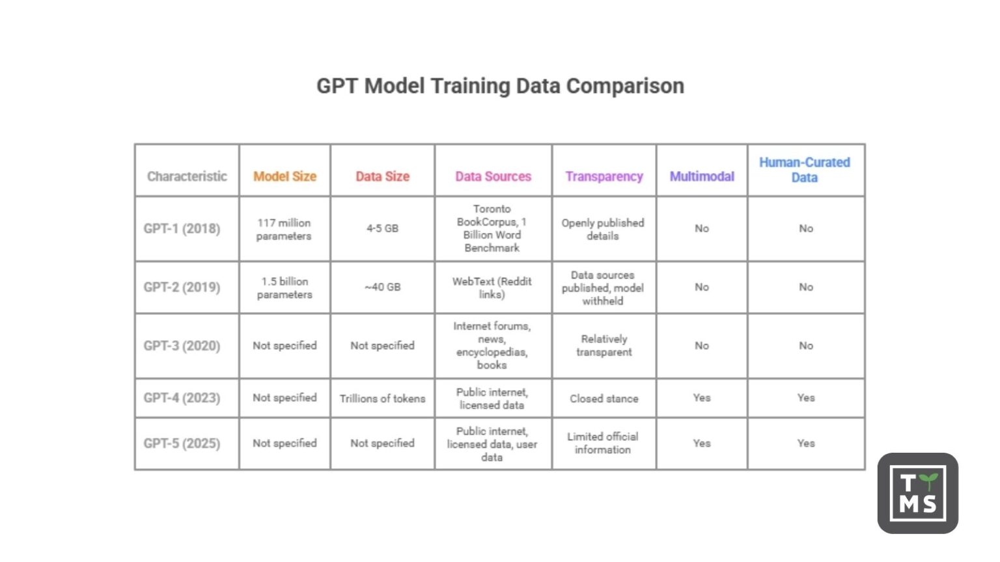
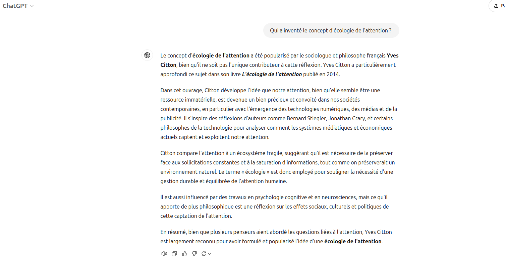
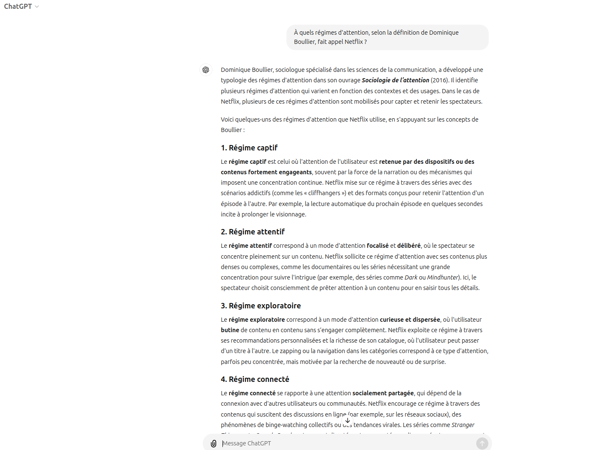
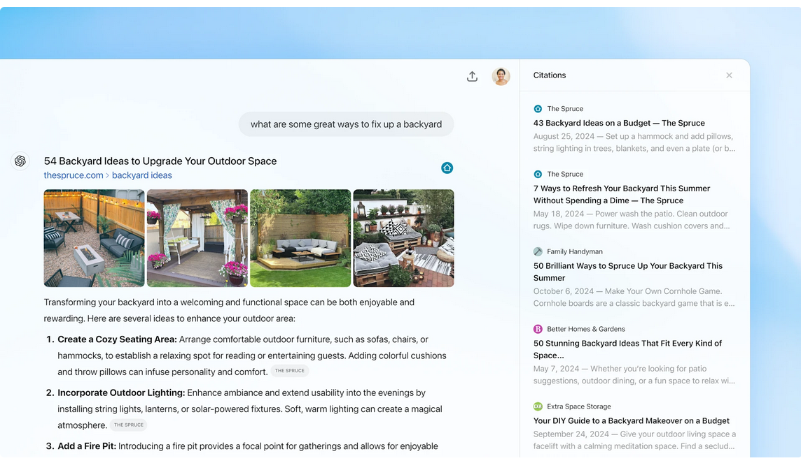

## Sous le nom "IA", qui parle ? 

<!-- .element: style="width:600px" -->

===

Les séances précédentes portaient le titre "de quoi l'IA est-elle le nom ?" : à la fois de rien de précis, et de tout un ensemble de théories, de technologies, de tentatives de modélisations de certaines tâches qui renvoient à des définitions parfois contradictoire de l'intelligence humaine. 

Il y a pire que cette tendance à parler d'IA de manière généraliste, sans préciser ni comprendre ce qu'elle englobe : il y a également la tendance à utiliser la synecdoque, c'est-à-dire une partie infime d'un phénomène pour en désigner le tout. 

Dans le champ des IAgénératives, c'est ChatGPT qui joue le rôle de cette synecdote. 

J'ai lancé une recherche dans GoogleScholar, moteur de recherche arrimé à une BDD d'articles scientifiques. J'y ai vu émerger à plusieurs reprise le terme d'ère de chatGPT. 
J'ai déjà un pb avec l'ère de l'IA : le terme "ère" suppose une rupture épistémologique majeure, que l’histoire de l’IA a tendance à relativiser : ça fait 70 ans qu'on fait des IA. Turing, Dartmouth, les systèmes experts et Deep Blue ont chacun participé à cette construction : et je n'ai fait là que sélectionner des grands moments. Mon histoire n'est pas exhaustive, elle est sélective. Des travaux sur l’histoire de l’IA montrent que son essor, des années 1950 au début des années 1970, s’est accompagné de la construction d’un puissant mythe culturel, celui de la machine pensante, lisible avec les notions d’« imaginaire » (Flichy) ou de « mythes modernes » (Mosco). La sidération actuelle tient en partie au fantasme d’une IA qui serait une nouveauté absolue, sans histoire ni précédent, ce qui est faux. On n'est pas entrés dans une ère de l'IA, ou alors on y est déjà depuis un demi siècle au moins. 
La notion d'ère, lorsqu'elle est nommée d’après une technologie, est totalement technodéterministe : elle attribue le changement social et sociétal à l’outil, alors qu’il passe aussi par des choix économiques, de droit et d’organisation du travail.
Enfin, la notion d'ère homogénéise la réalité : elle suggère un état unique du monde, des pratiques, des usages, des outils. 

Avec l'expression "à l'ère de ChatGPT", on va vers qq chose de pire encore. Nous seulement on homogénéise le réel, mais en plus, on associe un état du monde, une époque à un produit et à une marque. 
Le fait que ce soit ChatGPT ne relève pas du hasard. Cet outil de l'entreprise OpenAI, un chatbot conversationnel sorti fin novembre 2022, a permis au grand public d'accéder plus facilement au IA génératives, grâce à la mise en place d'une interface conversationnelle. Parler d’« ère de ChatGPT » désigne donc, à peu près, l’ère de l’ouverture au grand public.

Le problème, c'est que cette expression crée un phénomène d'invisibilisation : sire "l'ère de l'IA ou de ChatGPT" invisibilise 1) les IAG qui ne sont pas conversationnelles et tous les autres outils développés par d'autres entreprises qu'OpenAI. La reconnaissance de manuscrits, les modèles ouverts, les produits concurrents, les usages en bibliothèque ou en édition disparaissent derrière un seul nom.

On voit bien ici que la question n’est plus seulement ce qu’est l’IA (de quoi l'IA est-elle le nom), mais qui l’incarne concrètement: sous le nom d'IA, qui parle ? Aujourd'hui, c'est sans doute cela qui est le plus problématique : la question de la gouvernance de l'IA, mais aussi de sa privatisation. 

§§§§§§§§§§§§§§§§§§§§§§§§§§§§§§§§§§§§§§§§§§§§§

### Une nouvelle concentration

>Les acteurs principaux du secteur des agents d’IA sont OpenAI, Google et Anthropic, qui représentaient à eux trois plus de 84 % du secteur mondial au mois de mai 2026. À leurs côtés, on retrouve des entreprises qui sont soit déjà actives et intégrées verticalement, comme Amazon, Microsoft ou Nvidia, soit de nouvelles entreprises spécialisées de l’IA, comme Mistral AI, Perplexity AI ou xAI. 

>Avis 26-A-05 de l'Autorité de la concurrence (juillet 2026)

===

L’Autorité de la concurrence, dans un avis rendu le 17 juillet 2026 (avis 26-A-05) relève que OpenAI, Google et Anthropic représentaient à eux trois plus de 84 % du secteur mondial des agents d’IA en mai 2026. 

>Les acteurs principaux du secteur des agents d’IA sont OpenAI, Google et Anthropic, qui représentaient à eux trois plus de 84 % du secteur mondial au mois de mai 2026. À leurs côtés, on retrouve des entreprises qui sont soit déjà actives et intégrées verticalement, comme Amazon, Microsoft ou Nvidia, soit de nouvelles entreprises spécialisées de l’IA, comme Mistral AI, Perplexity AI ou xAI. 

https://www.autoritedelaconcurrence.fr/fr/avis/relatif-au-fonctionnement-concurrentiel-du-secteur-des-agents-dintelligence-artificielle

§§§§§§§§§§§§§§§§§§§§§§§§§§§§§§§§§§§§§§§§§§§§§

>Initialement conçus comme de simples agents conversationnels, les outils d’IA générative se sont progressivement transformés en agents d’IA. Ces derniers n’exécutent plus simplement des tâches isolées mais sont désormais capables de raisonner, de planifier et d’orchestrer plusieurs tâches en coordonnant d’autres agents d’IA dans une relative autonomie. Les termes « IA agentique » et « agents d’IA » ont été employés pour caractériser ces nouvelles capacités. Selon la Commission européenne, les agents d’IA sont « des applications logicielles conçues pour percevoir et interagir avec un environnement virtuel. Ils fonctionnent de manière autonome, c’est-à-dire sans être directement contrôlés par un humain ».

>Avis 26-A-05 de l'Autorité de la concurrence (juillet 2026)

===

Elle note aussi que des outils conçus comme de simples agents conversationnels se sont progressivement transformés en agents d’IA, et elle identifie un risque de « plateformisation ». Ce risque tient au fait que les éditeurs pourraient sélectionner les sources, classer les offres et déterminer les services visibles, avec des risques d’autopréférence ou d’influence liée à des partenariats commerciaux et à la publicité. L’avis est consultatif, et il ne crée pas d’obligation directe.

https://www.autoritedelaconcurrence.fr/fr/avis/relatif-au-fonctionnement-concurrentiel-du-secteur-des-agents-dintelligence-artificielle

§§§§§§§§§§§§§§§§§§§§§§§§§§§§§§§§§§§§§§§§§§§§§

Et si le problème n'était pas l'"IA", mais plutôt les entreprises qui produisent aujourd'hui les LLM et les outils dans lesquels ces LLM sont implémentés ?

§§§§§§§§§§§§§§§§§§§§§§§§§§§§§§§§§§§§§§§§§§§§§

Dans le cadre de vos navigations et de vos recheches, vous pouvez croiser et être amenés à utiliser plusieurs outils basés sur des LLM. Ces outils ont des fonctions différentes, gèrent des LLM plus ou moins spécialisés, et invisibilisent plus ou moins ces derniers.

§§§§§§§§§§§§§§§§§§§§§§§§§§§§§§§§§§§§§§§§§§§§§

#### Les interfaces conversationnelles (chatbots généralistes)

Les chatbots conversationnels sont des interfaces dans lequel l'usager peut interroger un LLM en langage naturel : ChatGPT, Claude, Gemini, Mistral Le Chat, etc.

<!-- .element: style="width:45%;float:left;margin-left:-1em; font-size:1.4rem; text-align:justify" -->

<!-- .element: style="width:45%;float:right;margin-right:-1em;" -->

===

1. Les interfaces conversationnelles (chatbots généralistes)

Les chatbots conversationnels sont des interfaces dans lequel l'usager peut interroger un LLM en langage naturel : ChatGPT, Claude, Gemini, Mistral Le Chat, etc.
 Cette catégorie est sans doute la plus connue, et celle que vous avez déjà testé ou que vous utilisez régulièrement. 

§§§§§§§§§§§§§§§§§§§§§§§§§§§§§§§§§§§§§§§§§§§§§

#### Les systèmes à récupération d’information (RAG)

Dans un outil RAG, le LLM est couplé à une base documentaire (un texte que vous avez soumis au ChatBot, des archives, une documentation interne) dans laquelle il va chercher avant de répondre. Le RAG garde une mémoire de cette base documentaire. La plupart des chatbots documentaires intègrent aujourd'hui une fonction RAG, même minimale. Un RAG grand public : NotebookLM.

<!-- .element: style="width:45%;float:left;margin-left:-1em; font-size:1.4rem; text-align:justify" -->

<!-- .element: style="width:45%;float:right;margin-right:-1em;" -->

===

Dans un outil RAG, le LLM est couplé à une base documentaire (un texte que vous avez soumis au ChatBot, des archives, une documentation interne) dans laquelle il va chercher avant de répondre. Le RAG garde une mémoire de cette base documentaire. La plupart des chatbots documentaires intègrent aujourd'hui une fonction RAG, même minimale. Un RAG grand public : NotebookLM.

§§§§§§§§§§§§§§§§§§§§§§§§§§§§§§§§§§§§§§§§§§§§§

#### Les agents

Un agent IA désigne un programme autonome dans lequel le LLM est utilisé pour analyser un objectif, utiliser des outils (navigateurs, code, base de données) et enchaîner les actions par lui-même (naviguer sur le Web pour chercher de l'information, consulter ou une base de données, écrire du code) pour accomplir une tâche sans intervention humaine à chaque étape. Exemple : appel commerciaux, SAV, Agent's room

<!-- .element: style="width:45%;float:left;margin-left:-1em; font-size:1.4rem; text-align:justify" -->

<!-- .element: style="width:45%;float:right;margin-right:-1em;" -->

===

Dans un agent, Le LLM planifie et enchaîne des actions avec des outils (navigation web, exécution de code, accès à des fichiers, envoi de messages). On les trouve dans les agents de navigation, les agents de programmation et les assistants bureautiques « délégataires ».

Exemple : les agent de support client utlisés par les service client de certaines entreprises pour répondre aux questions fréquentes, consulter les commandes et résoudre les problèmes de base.

Ou encore les appels téléphoniques que vous recevez pour vous vendre des services ou des produits : ici les Agents utilisent aussi des outils vocaux, et peuvent entretenir avec nous des conversation. 

Projet agentsroom : Le système sépare deux types d’agents : des agents de planification, qui étoffent les composantes du récit sans l’écrire, et des agents rédacteurs. Un orchestrateur central décompose la tâche et distribue les sous-tâches.

§§§§§§§§§§§§§§§§§§§§§§§§§§§§§§§§§§§§§§§§§§§§§

#### Les assistants intégrés à un logiciel existant (copilotes)

Le LLM est greffé à un outil du quotidien : traitement de texte, tableur, messagerie, éditeur de code, outils de PAO ou de montage. L’utilisateur ne « va » pas vers l’IA : elle est dans son environnement de travail. Exemple: résumé automatique de la conversation dans votre logiciel de messagerie. 

<!-- .element: style="width:45%;float:left;margin-left:-1em; font-size:1.4rem; text-align:justify" -->

<!-- .element: style="width:45%;float:right;margin-right:-1em;" -->

===

4. Les assistants intégrés à un logiciel existant (copilotes)

Le LLM est greffé à un outil du quotidien : traitement de texte, tableur, messagerie, éditeur de code, outils de PAO ou de montage. L’utilisateur ne « va » pas vers l’IA : elle est dans son environnement de travail. Cette catégorie est à mon sens la plus massive en usage réel, et la moins visible.

Ici sur canva, je propose des choses, et l'outil m'assiste sur des éléments de design (pour lesquels je n'ai aucune compétence). Même chose : je peux coder sans savoir coder. 

§§§§§§§§§§§§§§§§§§§§§§§§§§§§§§§§§§§§§§§§§§§§§

#### Les outils spécialisés par tâche (LLM « emballé »)

De nombreuses applications reposent sur des LLM qui en sont en quelque sorte le moteur invisible : logiciels de traduction (Deepl), correction et réécriture, résumé, **transcription** (HTR, par exemple), etc.

<!-- .element: style="width:45%;float:left;margin-left:-1em; font-size:1.4rem; text-align:justify" -->

<!-- .element: style="width:45%;float:right;margin-right:-1em;" -->

===

5. Les outils spécialisés par tâche (LLM « emballé »)

Des applications verticales dont le LLM est le moteur invisible : traduction, correction et réécriture, résumé, transcription et sous-titrage, génération de scripts ou de synopsis, outils d’aide à l’écriture de fiction. Pour l’édition, ce sont les plus directement concernés (relecture, aide à la rédaction de quatrièmes de couverture, métadonnées).

Ici un outil HTR : transcription automatisée

§§§§§§§§§§§§§§§§§§§§§§§§§§§§§§§§§§§§§§§§§§§§§

### Focus sur ChatGPT, l'IA générative de texte d'OpenAI

§§§§§§§§§§§§§§§§§§§§§§§§§§§§§§§§§§§§§§§§§§§§§

## ChatGPT ?

#### GPT (GPT3, GPT4, etc.)

* *Generative Pre-trained Transformer*
* un modèle géant de prédiction de texte entraîné par OpenAI sur 500 milliards de mots (pour GPT3) .
* un modèle encyclopédique
* = LLM (large language model)

<!-- .element: style="font-size:1.5rem; text-align:justify" -->

#### Chat (InstructGPT)

* Une interface conversationnelle
* Fonctionne à partir des requêtes de l'usager : "le prompt"

<!-- .element: style="font-size:1.5rem; text-align:justify" -->

===

GPT c’est Generative Pre-trained Transformer, un modèle géant de prédiction de texte entraîné par OpenAI sur 500 milliards de mots. GPT-3 est non seulement capable d’écrire correctement dans plusieurs langues mais c’est aussi un modèle encyclopédique qui intègre un grand nombre de références au monde réel (personnes, événements, connaissances scientifiques) qu’il restitue plus ou moins bien. GPT appartient à la famille des LLM, large language model, cad une catégorie de modèles entraînés à l’aide d’immenses quantités de données pour comprendre et générer des textes en langage naturel.

ChatGPT est aussi basé sur InstructGPT, un modèle conversationnel “d’apprentissage renforcé par retours humains”. Ce qui veut dire que pour bien faire fonctionner l'outil, il faut savoir l'interroger. 
C'est ce que l'on appelle l'art du prompt.

§§§§§§§§§§§§§§§§§§§§§§§§§§§§§§§§§§§§§§§§§§§§§

## Avec qui je "converse", lorsque j'échange avec ChatGPT ?

§§§§§§§§§§§§§§§§§§§§§§§§§§§§§§§§§§§§§§§§§§§§§

## [1] Un agent conversationnel intégré à une interface au design conçu pour masquer la technique

Avec ChatGPT, OpenAI a choisi de construire une IA qui **invisibilise** la technique. Cette stratégie est depuis longtemps pratiquée par les géants de la Tech : l'objectif est de designer des outils "faciles" à prendre en main, qui évite aux usagers de se poser trop de questions sur ce qu'ils renferment sous leur capot. L'invisibilisation de la technique, qui va de pair avec l'applification des systèmes informatiques depuis les années 2000, a rendu obsolète l'acquisition de compétences techniques et a généré une dépendance de plus en plus grande à des marques ou des services payants.  

<!-- .element: style="width:45%;float:left;margin-left:-1em; font-size:1.4rem; text-align:justify" -->

<!-- .element: style="width:45%;float:right;margin-right:-1em;" -->

§§§§§§§§§§§§§§§§§§§§§§§§§§§§§§§§§§§§§§§§§§§§§

<iframe width="560" height="315"
  src="https://www.youtube.com/embed/y0fzk6oRzPM?si=WS2BJBRO9ocYG9Qz&autoplay=1&mute=1"
  title="YouTube video player"
  frameborder="0"
  allow="accelerometer; autoplay; clipboard-write; encrypted-media; gyroscope; picture-in-picture; web-share"
  referrerpolicy="strict-origin-when-cross-origin"
  allowfullscreen></iframe>

===

steve jobs, it works like magic.

§§§§§§§§§§§§§§§§§§§§§§§§§§§§§§§§§§§§§§§§§§§§§

<!-- .element: style="width:45%;float:right;margin-right:-1em;" -->

Non Steve, la magie, c'est ça (et c'est de la fiction).

<!-- .element: style="width:45%;float:left;margin-left:-1em; font-size:1.4rem; text-align:justify" -->

===

Non Steeve, la magie, c'est ça (et c'est de la fiction).

§§§§§§§§§§§§§§§§§§§§§§§§§§§§§§§§§§§§§§§§§§§§§
<!-- .slide: data-background-image="img/emulateurEliza-1.png" data-background-size="contain" -->

Source : [Émulateur d'Eliza](img/https://web.njit.edu/~ronkowit/eliza.html)

<!-- .element class="source"-->

===
le tout premier chatbot psychothérapeute (1966) conçu par Joseph Weizenbaum. Version Javascript par Michael Wallace et George Dunlop

§§§§§§§§§§§§§§§§§§§§§§§§§§§§§§§§§§§§§§§§§§§§§
<!-- .slide: data-background-image="img/chat-bot-raphael.png" data-background-size="contain" -->

===

Aujourd'hui, construire des récits avec IA, c'est finalement d'abord construire des interfaces. On retrouve les enjeux de la plateformisation de écritures/lecture. 

§§§§§§§§§§§§§§§§§§§§§§§§§§§§§§§§§§§§§§§§§§§§§

### [2] Un LLM : un corpus de texte construit à partir du _big data_

>Quand nous posons une question à GPT-3 via l’interface ChatGPT nous dialoguons donc à la fois avec un mélange loin d’être chimiquement pur de l’un des plus vastes corpus de texte d’une humanité post-numérique mais aussi avec d’invisibles agencements de supervision qui n’ont rien à envier aux Pythies de Delphes. S’adresser à ChatGPT-3 c’est mettre à l’épreuve une immensité que l’on pense être suffisante pour détenir des réponses à chacune de nos questions. Entraînés que nous sommes depuis des années par l’habitus Google à considérer qu’il n’y a que des réponses. “Il n’y aura plus que des réponses“, prophétisait déjà Marguerite Duras. (Olivier Ertzscheid, ["C'est toi le chat"](https://www.educavox.fr/formation/analyse/olivier-ertzscheid-gpt-3-c-est-toi-le-chat))

<!-- .element: style="width:45%;float:left;margin-left:-1em; font-size:1.3rem; text-align:justify" -->

<!-- .element: style="width:45%;float:right;margin-right:-1em;" -->

===

Mais alors à qui parlons-nous vraiment quand nous posons à ChatGPT nos questions ? La question est ici mal posée. En vérité, ce qu'il faudrait questionner c'est : A quel “corpus” adressons-nous nos questions en espérant et en idéalisant les réponses pouvant nous être apportées ? À quel modèle de langage nous adressons-nous ? 

>Quand nous posons une question à GPT-3 via l’interface ChatGPT nous dialoguons donc à la fois avec un mélange loin d’être chimiquement pur de l’un des plus vastes corpus de texte d’une humanité post-numérique mais aussi avec d’invisibles agencements de supervision qui n’ont rien à envier aux Pythies de Delphes. S’adresser à ChatGPT-3 c’est mettre à l’épreuve une immensité que l’on pense être suffisante pour détenir des réponses à chacune de nos questions. 

>Concrètement le modèle de langage GPT-3 utilise le corpus Common Crawl, une base de donnée “ouverte” qui récupère (crawle) des milliards de mots issus de pages web et de liens, de manière aléatoire, puis les analyse et les “modélise” à l’aide de l’algorithme BPE qui va, grosso modo permettre d’effectuer sur ce corpus une première opération de tokenisation permettant une analyse lexicale et sémantique des unités collectées. GPT-3 s’appuie aussi sur un autre corpus, WebText2, qui lui agrège de la même manière des milliards de mots à partir des URL envoyés sur Reddit avec un score minimum de 3. GPT-3 s’appuie également sur deux autres corpus (Books1 et Books2) ainsi que sur une extractions de pages Wikipedia. 

§§§§§§§§§§§§§§§§§§§§§§§§§§§§§§§§§§§§§§§§§§§§§

===

Origine des données d’entraînement des modèles comme GPT parfois floue : OpenAI ne publie pas la totalité des spécifications sur la construction de ses modèles. 

Voici les trois catégories principales de données selon OpenAI :

- Données accessibles publiquement sur Internet (=Pages web, documents publics, forums, textes publics libres d’accès -> Contenu librement disponible et ouvert.)

=> ce type de données peut poser pb en termes de données personnelles

- Données sous licence ou partenaires tiers (=Contenu fourni ou licencié par des partenaires ou des fournisseurs de données -> Contenu auquel OpenAI a légalement accès).

- Données fournies ou générées avec participation humaine (Interactions d’utilisateurs, annotations, réponses humaines pour l’entraînement -> Inclut étiquetage humain pour améliorer la qualité).

=> on va parler ici de données annotées, modèles entraînés, fin-tunning. La question des droits humains pose ici parfois problème (digital labour). Je renvoie aux travaux d'Antonio Casilli sur le sujet.

De manière générale, la neutralité de ces llm, en dépit de leur dimension "gigantesque" (big data), n'est pas assurée.

§§§§§§§§§§§§§§§§§§§§§§§§§§§§§§§§§§§§§§§§§§§§§

### Les biais des LLM et VML 

En informatique, on parle de "biais" lorsque le résultat donné par un outil (algorithme, IA, etc.) n'est pas neutre, loyale ou équitable, pour des raisons inconscientes ou délibérées de la part de ses auteurs/programmeurs.  Écouter l'émission ["Tags, déchets, bâtiments délabrés : quand l'IA reproduit les stéréotypes sur les banlieues", par Noémie Lair, France Inter, novembre 2023](https://www.radiofrance.fr/franceinter/tags-dechets-batiments-delabres-quand-l-ia-reproduit-les-stereotypes-sur-les-banlieues-3334839)

<!-- .element: style="width:45%;float:left;margin-left:-1em; font-size:1.3rem; text-align:justify" -->

<!-- .element: style="width:45%;float:right;margin-right:-1em;" -->

§§§§§§§§§§§§§§§§§§§§§§§§§§§§§§§§§§§§§§§§§§§§§

Un biais algorithmique peut se produire lorsque les **données** utilisées pour entraîner un algorithme d'apprentissage automatique reflètent un sous échantillon non représentatif et non exhaustif de la population générale, et donc potentiellement des caractéristiques ou des valeurs implicites des humains impliqués dans la collecte, la sélection, ou l'utilisation de ces données.

<!-- .element: style="font-size:1.7rem; text-align:justify" -->

===

Il est important de comprendre le statut ontologique problématique des données numériques, qui sont fondamentalement des éléments extraits du réel de manière arbitraire, mais qui ont tendance à se substituer au réel, ou du moins à en tenir lieu dans notre imaginaire.

§§§§§§§§§§§§§§§§§§§§§§§§§§§§§§§§§§§§§§§§§§§§§

Les biais des IA, qui reposent sur nos propres préjugés, entraînent des résultats faussés et des conséquences potentiellement néfastes, tout en entretenant ces préjugés, voire en les aggravant.

<!-- .element: style="font-size:1.7rem; text-align:justify" -->

Si la fiabilité d'un logiciel d'IAG peut être remise en cause, ce n'est pas tant parce qu'il comprend des biais (**toute technologie dispose de ses propres biais**), mais parce que ces biais sont cachés et invisibilisés (comme dans ChatGPT).

<!-- .element: style="font-size:1.7rem; text-align:justify" -->

En régime numérique, plus que dans tout autre système d'information, la fiabilité dépend de la vérifiabilité. 

<!-- .element: style="font-size:1.7rem; text-align:justify" -->

===

Si un système de reconnaissance faciale fonctionne moins bien sur un groupe d’individus que sur un autre, les personnes sous-représentées peuvent alors avoir des difficultés à déverrouiller leur téléphone ou à être correctement identifiées par le système de sécurité d’un aéroport. Les biais algorithmiques peuvent aussi favoriser la discrimination avec des résultats de prévision de récidive inégaux ou encore des calculs de limite de crédits partiaux.

§§§§§§§§§§§§§§§§§§§§§§§§§§§§§§§§§§§§§§§§§§§§§

>Le problème de ChatGPT, enfin, c’est qu’il assigne pêle-mêle des faits, des opinions, des
informations et des connaissances à des stratégies conversationnelles, se présentant
comme encyclopédiques alors même que le projet encyclopédique, de Diderot et d’Alembert jusqu’à Wikipédia, est précisément d’isoler, de hiérarchiser et d’exclure ce qui relève de l’opinion
pour ne garder que ce qui relève d’un consensus définitoire de connaissances vérifiables.

<!-- .element: style="font-size:1.2rem; text-align:justify" -->

Olivier Ertzscheid, ["Google, Wikipédia et ChatGPT. Les trois cavaliers de l’apocalypse (qui ne vient pas)"](https://affordance.framasoft.org/2025/02/google-wikipedia-et-chatgpt-les-trois-cavaliers-de-lapocalypse-qui-ne-vient-pas/), novembre 2024.

<!-- .element: style="font-size:1.2rem; text-align:right" -->

§§§§§§§§§§§§§§§§§§§§§§§§§§§§§§§§§§§§§§§§§§§§§

## Avec qui conversons-nous, lorsque nous parlons avec ChatGPT ?

>Nous conversons tout à la fois avec les milliers de travailleurs pauvres qui « modèrent » les
productions discursives de la bête, mais aussi avec l’ensemble des textes qui ont été produits aussi
bien par des individus lambda dans des forums de discussion Reddit ou sur Wikipédia que par des
poètes ou des grands auteurs des siècles passés et enfin avec tout un tas d’autres nous-mêmes et
les archives de leurs conversations, qui sont aussi le corpus de ce tonneau des Danaïdes de nos discursivités. Quand nous parlons à ChatGPT, nous parlons à l’humanité toute entière, mais il n’est ni certain que nous ayons quelque chose d’intéressant à lui dire, ni même probable qu’elle nous écoute encore.

<!-- .element: style="font-size:1.2rem; text-align:justify" -->

Olivier Ertzscheid, ["Un Chat(GPT) dans le moteur, et réciproquement", AOC.media, nov 2024](https://aoc.media/analyse/2024/11/12/un-chatgpt-dans-le-moteur-et-reciproquement/)

<!-- .element: style="font-size:1.2rem; text-align:right" -->

§§§§§§§§§§§§§§§§§§§§§§§§§§§§§§§§§§§§§§§§§§§§§

### Pourquoi ChatGPT n'est PAS un moteur de recherche ?

ChatGPT n’a aucune compréhension de votre question ni même de sa réponse, qui résulte d'un calcul statistique croisant le contexte de votre requête et les différentes données qu’il a à sa disposition.

§§§§§§§§§§§§§§§§§§§§§§§§§§§§§§§§§§§§§§§§§§§§§

### Un modèle probabiliste

>L’épistémologie de GPT est probabiliste : plus un énoncé est présent dans le corpus d’entraînement et plus il a de chance d’être correctement restitué. C’est ainsi que chatGPT affirmera généralement que Napoléon a perdu à Waterloo tant cette information a pu être ressassée dans le corpus d’origine. Seulement dès qu’un énoncé est rarement présent où dès que le prompt d’origine prend une direction imprévue, le modèle peut facilement se perdre dans une série d’hallucinations.

<!-- .element: style="font-size:1.5rem; text-align:justify" -->

Source : Pierre-Carl Langlais, ["ChatGPT : comment ça marche ?", *Sciences communes*, 2023](https://scoms.hypotheses.org/1059).

<!-- .element: style="font-size:1.2rem; text-align:right" -->

===

Un exemple de l’épistémologie probabiliste de chatGPT : sur une question standard de culture générale, la réponse est presque toujours exacte. Sur un sujet de niche, il se plante. Il fait même plus : il hallucine.

§§§§§§§§§§§§§§§§§§§§§§§§§§§§§§§§§§§§§§§§§§§§§

#### Recherche sur un exemple médiatisé : hallucination partielle (bibliographie)

<!-- .element: style="width:800px" -->

===

Exemple avec un concept très médiatisé : écologie de l'attention

Erreur sur le titre du livre. 

§§§§§§§§§§§§§§§§§§§§§§§§§§§§§§§§§§§§§§§§§§§§§

#### Recherche spécialisée : hallucination complète

<!-- .element: style="width:800px" -->

===

exemple avec une typologie de niche, celle de Boullier.

Livre = Sociologie du numérique, 2019, et pas celui cité.

§§§§§§§§§§§§§§§§§§§§§§§§§§§§§§§§§§§§§§§§§§§§§

## _ChatGPT search_, un moteur ~~de recherche~~ de réponse

* Un service qui nous propose une synthèse de certaines sources en fonction de notre requête
* Une liste de sources (critères de sélection non précisés)
* Pas de rémunération des sources
* Une logique de plus en plus prescriptive
* Quid de la compétence d'évaluation et d'esprit critique ?

<!-- .element: style="width:45%;float:left;margin-left:-1em; font-size:1.3rem; text-align:justify" -->

<!-- .element: style="width:45%;float:right;margin-right:-1em;" -->

===

­une explication conversationnelle remplacera une simple liste de résultats pour celui qui depuis longtemps déjà se positionne et se veut davantage un moteur de réponses qu’un outil de recherche.

§§§§§§§§§§§§§§§§§§§§§§§§§§§§§§§§§§§§§§§§§§§§§

Utiliser des outils fondés sur des LLM pour la recherche ? 

- Attention aux outils grand public !
- Recherche expérimentale : intégrer la réflexion critique et méthodologique sur le LLM à sa recherche = renouer avec les Humanités numériques

§§§§§§§§§§§§§§§§§§§§§§§§§§§§§§§§§§§§§§§§§§§§§

